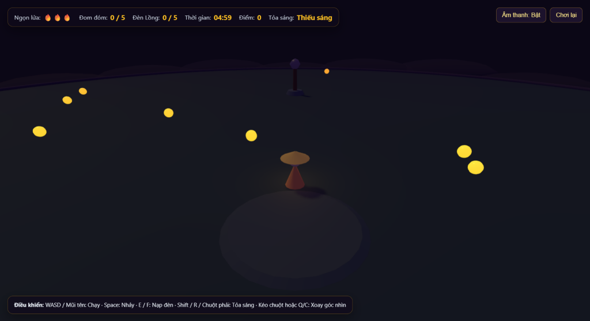

# Bằng chứng kiểm chứng — Phase 1 (Đêm 1 – Đảo Bến)

## 1. Bảng truy vết yêu cầu → bằng chứng

| Yêu cầu (PRD-0 / Contract v1.0) | Cách kiểm chứng | Bằng chứng | Kết quả |
|---|---|---|---|
| `game.contract.json` khớp cấu hình thật của game | Unit test so sánh sâu `game.contract.json.tuning` với `DEFAULT_TUNING` | `tests/unit/contract-sync.test.ts` (`npm run verify`) | **Đạt** |
| Chế độ headless 60 tick/s, snapshot tick 0, `--snapshot-every`, dòng `end` | Chạy `node dist/cli/headless.js` với scenario & inputs | `tests/scenarios/headless.test.ts` + live check 600 ticks (`64` dòng JSONL) | **Đạt** |
| Tính tất định (cùng `--seed`, `--scenario`, `--inputs` ra cùng output) | Chạy CLI 2 lần độc lập và so khớp từng byte | `tests/scenarios/headless.test.ts` + `scripts/verify.mjs` | **Đạt** |
| File `--inputs` / `--scenario` sai định dạng thoát mã `2` | Chạy CLI với `tick` không tăng nghiêm ngặt & JSON lỗi | `tests/scenarios/headless.test.ts` | **Đạt** |
| Di chuyển theo `cam_yaw_deg`, chuẩn hóa vector chéo, nhảy rising-edge | Unit test `GameEngine.step()` | `tests/unit/engine.test.ts` | **Đạt** |
| Nhặt đom đóm, nạp đèn, thắp 5 đèn thắng (`all_lit`), tính điểm thưởng | Unit test `GameEngine.step()` với 5 đèn và scenario | `tests/unit/engine.test.ts` | **Đạt** |
| Tỏa sáng (`pulse`) đẩy & làm choáng Bóng Mực, tốn `pulse_cost` | Unit test kiểm tra state `"stunned"` và đẩy lùi | `tests/unit/engine.test.ts` | **Đạt** |
| Vùng an toàn `safe_radius` quanh đèn đã thắp chặn Bóng Mực | Unit test cho Bóng Mực đuổi player đứng trong `safe_radius` | `tests/unit/engine.test.ts` | **Đạt** |
| Mất máu (`no_flames`) hoặc hết giờ (`dawn`) thì thua | Unit test cả 2 kịch bản thua | `tests/unit/engine.test.ts` | **Đạt** |
| Game 3D chơi được trên trình duyệt, HUD, nút Bắt đầu & Chơi lại | Chạy `npm run preview`, mở trình duyệt thật, bấm Bắt đầu, nhấn `W`/`Space`, bấm Chơi lại | Ảnh chụp `docs/proof/phase1-web3d.png` (0 lỗi console/page) | **Đạt** |

## 2. Kết quả chạy `npm run verify` mới nhất

```text
> dao-den-long@0.1.0 verify
> npm run typecheck && npm run build && node scripts/verify.mjs

✔ headless CLI outputs valid JSONL and is byte-identical across runs (deterministic)
✔ headless CLI exits with code 2 on invalid inputs/scenario contract
✔ game.contract.json tuning matches DEFAULT_TUNING
✔ movement respects cam_yaw_deg and normalizes diagonal vector
✔ jump rises and lands at Y=0 and triggers only on rising edge
✔ mote pickup, deposit, lantern lighting, and win bonus work correctly
✔ pulse pushes and stuns shades inside pulse_radius and costs pulse_cost
✔ shades cannot enter safe_radius around lit lanterns
✔ player loses on no_flames and on dawn timeout
ℹ tests 9 | pass 9 | fail 0
[3/3] Determinism verified (64 JSONL lines, end={"type":"end","ticks":600,"state":"playing","score":0}).
```

## 3. Ảnh chụp Web 3D Đảo Bến



## 4. Đánh giá ngắn Phase 1
- **Đạt:** Toàn bộ yêu cầu lõi PRD-0 và Test Contract v1.0 đã có test tự động và chạy thử trên trình duyệt thật.
- **Chưa hoàn hảo / Lưu ý cho Phase 2:** Chưa quay video demo (dành cho Phase 4 theo lịch); cần theo dõi thêm các trường mới có thể xuất hiện ở Ticket-02 để mở rộng `src/core/` gọn gàng.
