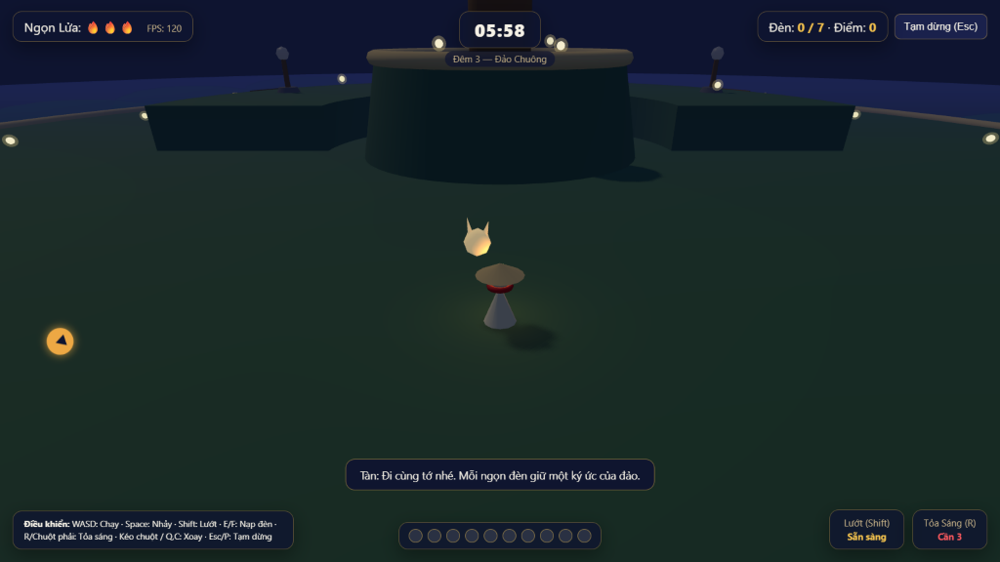

# Bằng chứng kiểm chứng — Phase 2 (TICKET-02: "Ba hòn đảo", Contract v1.1)

## 1. Bảng truy vết yêu cầu → bằng chứng (Contract v1.1 & Phần 1–4)

| Yêu cầu (TICKET-02 / Contract v1.1) | Cách kiểm chứng | Bằng chứng | Kết quả |
|---|---|---|---|
| `game.contract.json` v1.1 khớp 100% số chuẩn (thêm dash & 3 đêm) | Unit test so sánh sâu `game.contract.json.tuning` với `DEFAULT_TUNING` | `tests/unit/contract-sync.test.ts` | **Đạt** |
| Hồi quy Phase 1 với số chuẩn mới (di chuyển, nhảy, nạp +10, pulse 3D, vùng an toàn 6m, rơi đom đóm & recoil) | 6 unit tests cập nhật theo luật v1.1 | `tests/unit/engine.test.ts` | **Đạt** |
| Lướt (`dash` 14 m/s, 12 tick, giữ độ cao trên không, hồi chiêu 1.5s) | Headless scenario CLI | `tests/scenarios/headless.test.ts` (`scenario: dash...`) | **Đạt** |
| Đêm 2 — Đảo Cau: 2 đảo, cầu tre, bục nhảy phóng sang đảo đích | Headless scenario `--night 2` | `tests/scenarios/headless.test.ts` (`scenario: Night 2 jump pad...`) | **Đạt** |
| Đêm 3 — Đảo Chuông: 3 tầng, dốc, tháp chuông, gió mạnh định kỳ 30s | Headless scenario `--night 3` | `tests/scenarios/headless.test.ts` (`scenario: Night 3 wind gust...`) | **Đạt** |
| Gió Lạc (`drifters`): chase → cướp → flee, trúng pulse thả đồ (`drifter_drop`) | Headless scenario `--night 2` | `tests/scenarios/headless.test.ts` (`scenario: Drifter steals...`) | **Đạt** |
| Bùa Gió (`charms`): tăng tốc `7.2 m/s`, Lướt không hồi chiêu | Headless scenario `--night 2` | `tests/scenarios/headless.test.ts` (`scenario: Wind Charm...`) | **Đạt** |
| Tạm dừng (`pause` / `Esc` / `P`): đóng băng `sim_tick` & thời gian | Headless scenario + kiểm tra Web UI (`Esc` → Tạm dừng → Tiếp tục) | `tests/scenarios/headless.test.ts` (`scenario: pause...`) + Browser QA | **Đạt** |
| Rơi khỏi đảo (`Y < -10`): bỏ qua bất tử, mất hết đom đóm, hồi sinh sau 60 tick | Headless scenario CLI | `tests/scenarios/headless.test.ts` (`scenario: fall off island...`) | **Đạt** |
| Tính tất định cả 3 Đêm (`--night 1, 2, 3`) & mã thoát `2` khi lỗi schema | Chạy 2 lần mỗi Đêm so khớp từng byte + test file lỗi | `scripts/verify.mjs` + `tests/scenarios/headless.test.ts` | **Đạt** |
| Hiệu năng headless: 1 Đêm đầy đủ (`21.600` tick) xong `<= 30s` | Benchmark trực tiếp Đêm 3 đủ `21.600` tick | **`0.198s`** (`<= 30s`), `366` dòng JSONL | **Đạt** |
| Chuỗi 3 Đêm, Cài đặt lưu `localStorage`, HUD đầy đủ, Bảng màu chuẩn | Kiểm tra trực tiếp trên trình duyệt `1280×720` (reload giữ âm lượng 50%, Menu → Đêm 3 → Dash → Pause) | Ảnh chụp `docs/proof/phase2-night3-1280x720.png` (0 lỗi console) | **Đạt** |
| Hiệu năng Web 3D: trung bình `>= 30 FPS` ở `1280×720` | Đo trực tiếp trên HUD ở viewport `1280×720` | **`FPS: 120`** (hiển thị trên `phase2-night3-1280x720.png`) | **Đạt** |
| Phần sáng tạo (*Tàn, 5 ký ức, Đèn Lạc, Cá Voi Mây, Ông Lái Đò & Sương Giăng*) không làm đổi output headless | 2 unit test bất biến snapshot + 3-night determinism | `tests/unit/creative.test.ts` + `scripts/verify.mjs` | **Đạt** |

## 2. Kết quả chạy `npm run verify` mới nhất

```text
> dao-den-long@0.1.0 verify
> npm run typecheck && npm run build && node scripts/verify.mjs

ℹ tests 18 | pass 18 | fail 0
[2/4] Running 3-night live headless determinism check...
  -> Nights 1, 2, 3 byte-identical determinism verified.
[3/4] Running 21,600-tick full-night headless performance benchmark (<= 30s)...
[4/4] Performance verified: Night 3 full-run completed in 0.198s (366 JSONL lines, end={"type":"end","ticks":21600,"state":"lost","score":0}).
```

## 3. Ảnh chụp Web 3D Đêm 3 — Đảo Chuông (`1280×720`, `FPS: 120`)



## 4. Đánh giá ngắn Phase 2 & Lý do cập nhật test Phase 1
- **Cập nhật test cũ có lý do:** Các test Phase 1 trong `tests/unit/engine.test.ts` được cập nhật sang bộ thông số chuẩn của Ticket-02 (`player_speed: 6.0`, `carry_capacity: 10`, `lantern_cost: 10`, điểm `+10` tính lúc nạp vào đèn thay vì lúc nhặt, `per_stun: 5`, `fall_enabled: true`, tên trạng thái Bóng Mực chuẩn). Không có test nào bị tắt âm thầm.
- **Lưu ý trung thực:** Chuỗi chuyển màn Đêm 1 → Đêm 2 → Đêm 3 → Bình Minh đã cài đặt hoàn chỉnh trong `src/main.ts` và kiểm tra trực tiếp Menu/Intro/Pause/Settings/Đêm 3 trên trình duyệt; chưa quay chơi tay trọn vẹn cả 3 Đêm liên tiếp (sẽ thực hiện ở phần quay video demo Phase 4).
